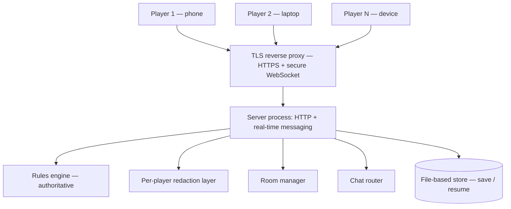
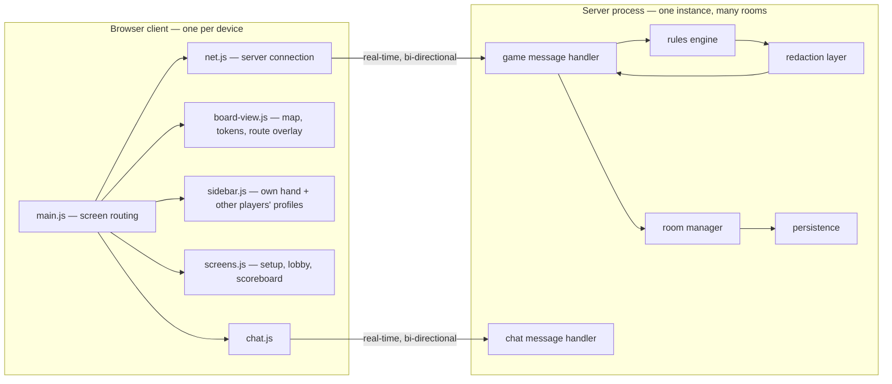
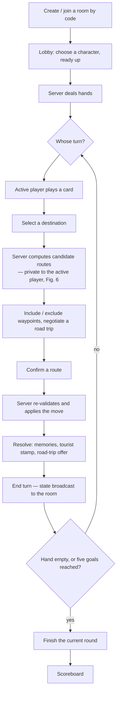
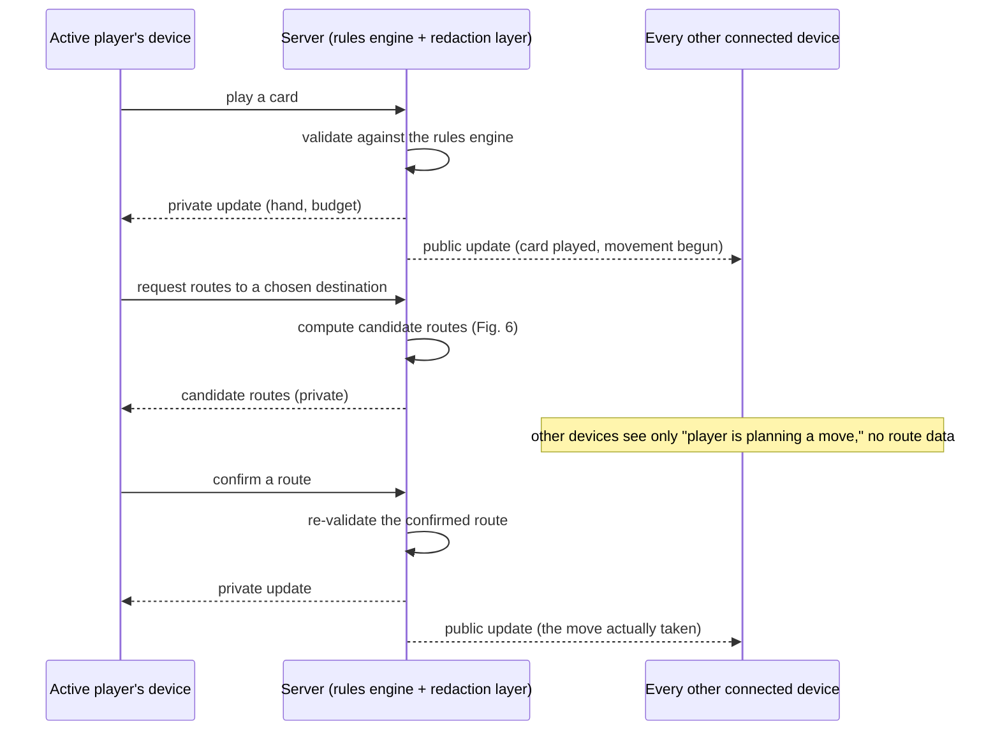
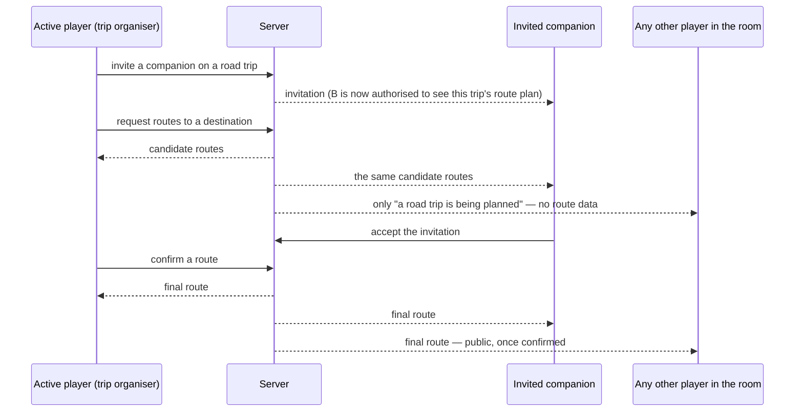

# RAHEE — Design Plan

**CS 202: Software Development Project**
**Team 31** — Tanuj Sharma (23110331) · Sai Gawali (23110114) · Siddhesh Patil (23110240) · Mukesh Dewangan (23110211) · Kshitij Kasodkar (23110175)
**Date:** 13 September 2026

## Abstract

RAHEE is a travel-themed board game designed by CCL, IIT Gandhinagar, in which two to six players journey across a map of India. Each player's starting hand of playing cards is their entire itinerary: a card is played to move a fixed number of steps between cities, spending money from a fixed budget, and points are scored by visiting tourist places, reaching character-specific destination goals, and collecting sets of themed "memory" tokens. The project builds a digital version of this game.

This document is the design plan for a **real-time, secure, multi-device online game**, in which every player connects from their own phone or laptop and plays together in the same session, as required by the project's signed requirements sheet. It follows the five-part format specified for this submission: architecture and design decisions, the requirements the architecture targets, diagrams of the system's structure, the major code modules and how they communicate, and an explanation of how the design satisfies the stated requirements.

---

## 0. Game overview

Before describing the architecture, a brief summary of the game itself, since the design decisions below only make sense in relation to its rules:

- **Players and setup.** Two to six players each choose a character with a printed starting city and six destination goals, and are dealt a fixed hand of playing cards. No card is ever drawn again after setup — the entire hand is the player's itinerary for the whole game.
- **A turn.** A player plays one card and moves between 1 and the card's value in steps along connected routes, paying a fixed cost per step (plus surcharges for flights and ferries) out of a starting budget. Ending a move may earn "memory" tokens of the played card's suit, and may allow the player to pay to mark a tourist stamp.
- **Road trips.** A player who ends their move in a city occupied by other players may invite them on a shared "road trip," pooling movement and splitting costs and rewards.
- **Scoring.** The game ends once a player empties their hand or reaches five destination goals, after which the round is completed. Points are awarded for tourist places visited, destinations reached, and sets of memory tokens, with a penalty for overspending.

The rules themselves are not part of this design plan — they are fixed by the physical game and are to be enforced in full by the rules engine described in §1. This document is only about **how the software is to be built**, in line with the project's own emphasis that "the main requirement is not the game but how it is built."

---

## 1. Architecture

### 1.1 Core principle: a dependency-free rules engine

The proposed architecture is built around one governing rule for the module that decides what is legal, what things cost, and how the game is scored: it must know nothing about any specific board, and it must not depend on the browser's display layer (the "DOM") in any way. Every city, route, character, price, and scoring value is instead to be read from one structured data file when the game starts. Under this rule, the entire board — cities, routes, characters, destination goals, and the full pricing and scoring table — becomes editable purely as data, with no change required to the module that enforces the rules.

This principle is adopted for two reasons. First, it satisfies the requirement that the board be entirely data-driven, so that correcting the map or editing a character's goals never requires a code change. Second, and this is what shapes every decision in §1.2, a module with no dependency on a browser is a module that can run unmodified on a server. Designing the rules engine this way from the outset is what allows the same code to serve, unchanged, as the single authoritative source of truth for every game in progress.

### 1.2 Design decisions for the online architecture

| Decision | Rationale |
|---|---|
| **Client–server, with the server as sole authority on the rules.** The rules engine runs as a single, dependency-free server-side module and is the one source of truth for every game in progress. | Once players are on separate, independent devices, a client cannot be trusted to report its own moves correctly — a tampered or buggy client could otherwise claim an illegal move, a free flight, or an extra point. Validating every action once, centrally, removes that risk entirely. |
| **Persistent, bidirectional connections (WebSockets) between each device and the server**, grouped into "rooms," one per game in progress. | The game needs to push updates to players as they happen (a rival's move, an incoming chat message, an invitation to a road trip) rather than waiting for each device to ask. A room-based real-time connection also gives built-in reconnection handling, important for players on mobile data. |
| **Join by room code, no account system.** One player creates a game and shares a short code; others join with it from their own device. | This mirrors how the physical game is actually played — one person owns the box, everyone else pulls up a chair — and avoids account-creation friction on a phone. |
| **A dedicated redaction step between the rules engine and the network**, rather than hiding information in the browser. | Several pieces of state are private by rule: a player's hand of cards, their exact spending, and — per this project's own added requirement — an in-progress route being planned, which should be visible only to the player planning it and to anyone they have invited on that trip. Filtering this in the browser would still send the data to the browser; the redaction must happen on the server, before anything is transmitted. |
| **A lightweight, file-based database for saving game state**, rather than a full database server. | The game is turn-based with a small number of players and a low rate of state changes, so a heavyweight database is unnecessary. A file-based store is enough to survive a server restart and to support saving and resuming a game later, while avoiding unnecessary infrastructure. |
| **A single-device mode as one configuration of the same system**, not a separate build. A room may have one device per player, or one shared device stepping through a private handover screen for every seat. | This avoids maintaining two versions of the game: the same private-handover screen built for a single shared device also serves every seat in that mode, with no second implementation. |

### 1.3 Frameworks and tools planned

| Layer | Choice | Reason |
|---|---|---|
| Rules engine | A single, dependency-free rules-engine module | Written with no browser dependency, per §1.1, so it can run unmodified on the server. |
| Server runtime | Node.js, with a small HTTP framework (Express) and a real-time messaging library (Socket.IO) | Same language as the rules engine, avoiding a rewrite; Socket.IO provides room grouping, automatic reconnection, and a fallback transport for networks that restrict raw WebSocket traffic. |
| Client | Plain JavaScript modules and an SVG-based map view | No build step and no framework to keep up to date, keeping the client simple to maintain and debug. |
| Data storage | An embedded, file-based database (SQLite) | Zero server setup, adequate for a turn-based game's write volume, and sufficient for save/resume. |
| Input validation | A schema-validation library at the server boundary | Every message arriving from a client is, by definition, untrusted input and must be checked before use. |
| Transport security | TLS (HTTPS/WSS) via a reverse proxy in production | Required for any real deployment, and necessary in practice since mobile browsers refuse insecure connections for this kind of application. |
| Testing | A unit-test runner for the rules engine, and a browser-automation tool capable of driving several simulated devices in one test | The rules engine can be tested in isolation from the network layer; multiplayer behaviour — in particular, that private information stays private — is tested by opening several independent browser sessions against one server, standing in for several real devices. |

### 1.4 Project structure (production code)

The following is the intended file layout for the production code — the files that ship in the running game. Supporting material used only while producing the board data or documentation is intentionally left out of this listing.

```
Rahee/
├── index.html              the page every player loads
├── data/
│   └── board.json          the entire board: cities, routes, characters, prices, scoring
├── assets/
│   └── board-plate.png     the map image drawn beneath the board
├── shared/
│   └── engine.js            rules and game state — no board knowledge, no browser dependency (§1.1)
├── client/                   runs in each player's browser
│   ├── main.js               screen routing and the turn-action panel
│   ├── net.js                the connection to the server
│   ├── chat.js                public and private chat
│   ├── board-view.js         renders the map, routes and player tokens
│   ├── sidebar.js            renders hand, budget, memories and other players' profiles
│   ├── screens.js            setup, private handover, and the final scoreboard
│   └── styles.css
└── server/                   one Node.js process, shared by every room
    ├── app.js                starts the HTTP and real-time server
    ├── rooms.js              creates rooms, assigns seats, expires idle games
    ├── state-view.js         redacts game state per player before sending it
    ├── persistence.js        saves and restores game state
    └── sockets/
        ├── game.js           handles card plays, movement, road trips
        └── chat.js           handles public and private messages
```

The rules engine lives in a shared location so that it can be imported unmodified by both the client, where it can optionally predict and highlight legal moves, and the server, where it is the sole authority. Every module under `client/` has a single, clearly scoped responsibility (§4); everything under `server/` implements the network and persistence layer around the shared engine.

---

## 2. Requirements the architecture is intended to satisfy

| Category | Requirement | Design response |
|---|---|---|
| **Functionality** | Two to six players, each on their own device, with every rule of the physical game enforced consistently for every player | A single, dependency-free rules engine, run once per game on the server (§1.1, §4) |
| **Functionality** | A public chat visible to the whole game, and a private chat between two specific players, to support negotiating road trips | Routed over the same real-time connection as game state, with separate message scopes (§4) |
| **Security** | A player's hand, their exact spending, and an in-progress route plan must never be delivered to a device not entitled to see them — an access-control property, not merely a display one | A dedicated redaction step runs on the server for every outgoing message; nothing is ever sent broadly and hidden afterward (§1.2, §5) |
| **Security** | No device should be able to grant itself an illegal move, an unpaid journey, or an extra point | Every action received from a client is checked against the rules engine on the server before it is applied or announced to anyone (§4) |
| **Security** | Chat must not allow malicious content or spam | Server-side message sanitisation and a limit on how quickly one device can send messages or route queries |
| **Reliability** | A dropped connection during a player's turn (a realistic failure mode on mobile networks) should not remove them from the game | A reconnection token tied to the player's seat, combined with automatic reconnection and a replay of the current state on rejoin |
| **Reliability** | An unfinished game should be resumable later | Game state is written to the file-based store at the end of every turn and whenever the last connected device disconnects |
| **Performance** | Turn actions and chat should feel immediate over ordinary mobile or campus networks | The game is turn-based with low message volume; a single server process comfortably handles this without additional infrastructure |
| **Extensibility** | The board, its prices and its scoring must remain editable as pure data | The single board data file is the engine's only source of board knowledge (§1.1, §1.4) |
| **Usability** | The game must be usable one-handed on a phone, with no installation step | A responsive layout, touch-first controls on the map, and joining by typing a short room code |

---

## 3. Diagrammatic structure of the system

### Figure 1 — overall structure: components and interfaces



### Figure 2 — module communication, client and server



### Figure 3 — run-time structure: gameplay flow for one room



### Figure 4 — run-time process interaction: one turn across every connected device



### Figure 5 — data structures: what the server sends to whom

```
Broadcast to the whole room (everyone sees this):
  room id, current phase, whose turn it is,
  for each player: name, character, current city, money spent,
                   number of tourist stamps, memory counts, road-trip
                   cards remaining — counted, never shown card-by-card

Sent only to one player's own device:
  their hand of cards
  their full budget breakdown
  their current route plan, if any, and who else is allowed to see it
```

### Figure 6 — the private route-planning interaction

The rules engine's core movement logic determines the single next legal step available from a player's current position. The added requirement is richer: a player selects a *destination*, is shown every possible route there within their card's remaining movement allowance, and may narrow that set down by including or excluding intermediate cities — and this exploration must stay visible only to the player doing it, plus anyone they have invited on a shared road trip.

This is designed as a bounded search from the player's current city, limited to the largest possible movement allowance (at most 10–11 steps), stopping early on any path that already exceeds the steps remaining. Because the board has 101 cities and 209 routes, this remains a small computation — an extension of the same graph-search approach (breadth-first search) used elsewhere in the engine, not a new class of algorithm.



| Who | Sees the routes being considered? | Sees the final route taken? |
|---|---|---|
| The player planning the move | Yes, in full, as they narrow it down | Yes |
| A player they have invited on that trip | Yes, from the moment of the invitation | Yes |
| Any other player in the room | No — only that planning is happening | Yes, once it is confirmed |

This mirrors how the physical game already works: everyone watches a token move once it moves, but a player thinking aloud over the map before committing is not narrating that thought process to the whole table.

---

## 4. Major modules and how they communicate

### Client modules — one running instance per device

| Module | Responsibility |
|---|---|
| `board-view.js` | Draws the map, routes and tokens; highlights legal moves; overlays a route plan when the current device is authorised to see one. |
| `sidebar.js` | Shows the owning player's hand, budget and memories privately, and a public summary strip (character, city, stamps, memory counts) for every other player. |
| `screens.js` | Game setup, joining a room, the private handover screen for shared-device seats, and the final scoreboard. |
| `main.js` | Routes between screens and drives the turn-action controls, reacting to updates pushed from the server. |
| `net.js` | Owns the connection to the server and exposes the actions a player can take (play a card, query a route, send a chat message) as simple function calls. |
| `chat.js` | The public chat panel and one thread per private conversation. |

### Server modules — one process serving every room

| Module | Responsibility |
|---|---|
| Rules engine (shared) | The sole authority on what moves are legal, what they cost, and how they score. |
| Redaction layer | Given the full state of a game and one player's identity, produces the version of that state that player is allowed to see. |
| Room manager | Creates rooms and their join codes, assigns connecting devices to seats, and expires rooms left idle. |
| Game message handler | Receives every card-play, movement, and road-trip action, passes it to the rules engine, and broadcasts the (redacted) result. |
| Chat message handler | Receives and routes public and private messages, after sanitising their content. |
| Persistence | Saves and restores game state, and issues the tokens used to reconnect a dropped player to their seat. |

### Messages exchanged between client and server

| Message | Sent by | Received by |
|---|---|---|
| Join or reconnect to a room | client | server |
| Play a card / move / end turn | client | server |
| Request or confirm a route | client | server |
| Invite, accept, or leave a road trip | client | server |
| Public or private chat message | either side | the room, or one specific player |
| Public game-state update | server | every device in the room |
| Private state update (hand, budget) | server | one device only |
| Route plan | server | only the planning player and their invited companions |
| Presence notice ("a player is planning a move") | server | every other device, with no route detail |
| Action rejected, with a reason | server | the device whose action was invalid |

---

## 5. How the structure and design decisions satisfy the requirements

| Requirement (§2) | Satisfied by |
|---|---|
| Play online, each from a separate device | A server-authoritative room reached by every device over a persistent real-time connection (§1.2, Fig. 1) |
| Public and private chat | A shared connection carrying two distinct message scopes (§4) |
| Every rule of the physical game enforced consistently | A single, server-side rules engine designed with no board or browser dependency (§1.1, §1.2) |
| The board remains a pure data change | The board data file is the engine's only source of board knowledge (§1.1, §1.4) |
| Hands and route plans stay private | A redaction step runs before any message leaves the server, rather than being filtered afterward in the browser (§4, Fig. 6) |
| Other players' progress is visible | The public, redacted state update includes a summary of every player's character and progress (Fig. 5) |
| Resilient to a dropped connection | A reconnection token tied to a seat, combined with automatic reconnection and a replay of current state (§1.2, §2) |
| A game can be saved and resumed | State is written to the file-based store at natural checkpoints — the end of a turn, and a room going empty (§1.2) |
| Usable on a phone | A responsive layout and touch-first controls, joined without installing anything (§1.3) |
| A single shared device is still supported | The private handover screen is reused as one configuration of the same room, not a separate build (§1.2) |

**Summary.** Every requirement above is satisfied by keeping the rules engine free of any board knowledge or browser dependency from the outset (§1.1), and building the server process, the redaction layer, and the real-time connection as a layer *around* that engine, never inside it. This keeps the system's most critical logic — the rules themselves — isolated and independently testable, and free to run in either a client (for optional prediction) or the authoritative server, with no change to the module itself.

---

## Appendix A — Mobile and responsive design

| Element | Desktop | Phone (narrow screens) |
|---|---|---|
| Map | Pan-and-zoom, centred on screen | Same map; touch gestures are mapped onto the same pan/zoom controls |
| Player panel (own hand, other players' profiles) | Fixed side column | Collapsible panel, opened with a swipe |
| Turn controls | Below the map | A fixed bar at the bottom of the screen, within thumb's reach |
| Chat | Side panel | A separate tab, with an indicator for unread messages |
| Route planning (Fig. 6) | Highlighted lines on the map, plus a list of candidate routes | Highlighted lines on the map, cycled through by tapping |

## Appendix B — Points requiring confirmation from the client

A small number of rule interpretations affect this design and are not fully settled by the written rules provided to the team:

1. Whether reaching a character's destination goal requires paying to formally visit that city as a tourist place, or is scored simply by ending a move there.
2. The exact movement cost of each route segment on the printed board, pending the connection data promised by the client; every route is currently treated as one step until that data arrives.
3. Whether the game's winner is strictly the player who first triggers the end of the game, or the player with the highest final score once the round is completed — the requirements sheet states both, and they are not equivalent.

None of these affect the architecture described above; each is confined to the rules engine's scoring logic and can be resolved as a data or logic change without touching the design in this document.

## Appendix C — Tooling for development

| Category | Tools |
|---|---|
| Runtime and package management | Node.js (a fixed, pinned version), npm |
| Server libraries | A minimal HTTP framework, a real-time messaging library, an embedded database library, a schema-validation library, a structured logging library |
| Testing | A unit-test runner for the rules engine; a browser-automation tool capable of driving several simulated devices in one test, used specifically to verify that private information (hands, route plans) never reaches an unauthorised device |
| Code quality | A linter and an automatic code formatter, run on every change |
| Type checking | Static type checking against the JavaScript source, without introducing a build step |
| Pre-commit checks | An automatic check, run before each commit, that lints, formats, and runs the fastest tests against the changed files |
| Continuous integration (GitHub Actions) | One workflow that installs dependencies, lints, type-checks, and runs both the unit and multi-device tests on every change; a second that runs an automated security scan against the code for vulnerabilities such as unsafe handling of untrusted input; a third that automatically opens pull requests for outdated dependencies; a fourth that deploys the application once the above checks pass on the main branch |
| Deployment | A single, always-on server process (this application is not suited to a purely static file host, since it requires a persistent connection to every player), reached only over an encrypted connection |
| Monitoring | Structured server logs and a basic uptime check, so that a problem affecting a game in progress can be diagnosed after the fact |

---

*This plan describes the proposed architecture for RAHEE's online multiplayer implementation. The rules summarised in §0 and the requirements in §2 are drawn from the project's official rulebook and its signed requirements sheet, both already submitted to the course.*
