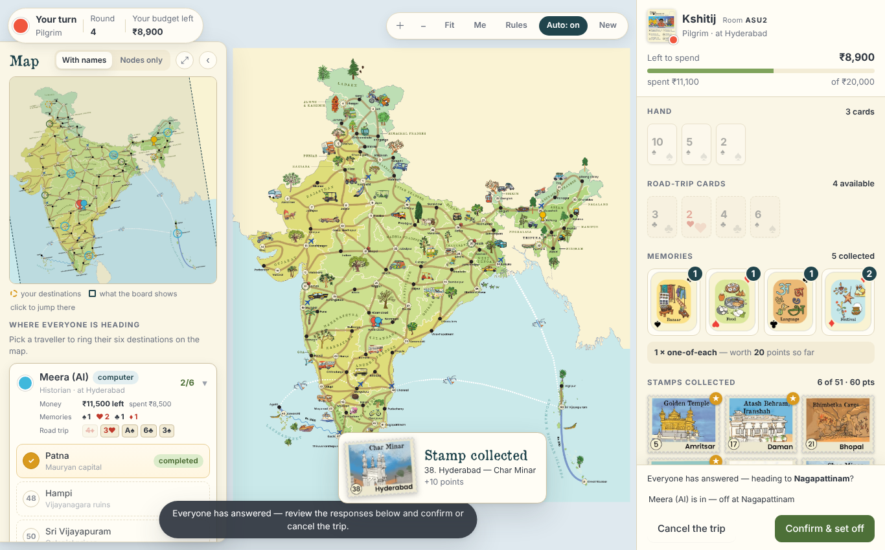
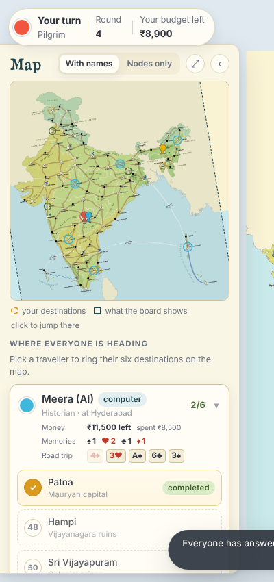
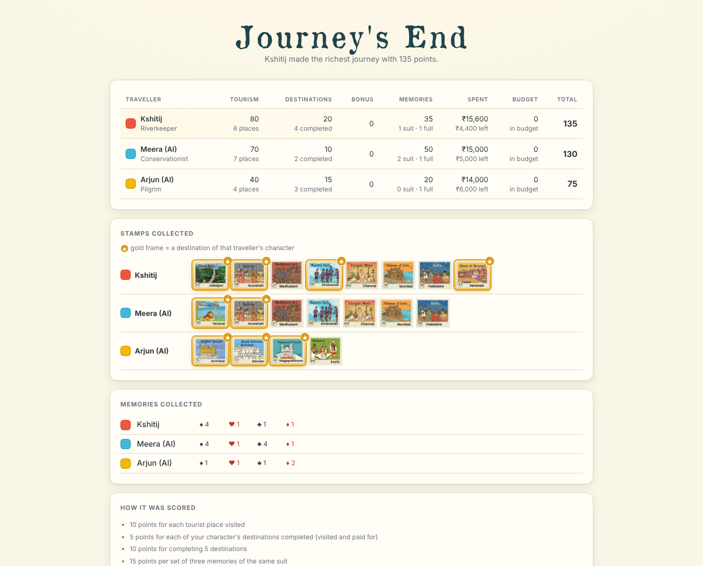

# 🗺️ RAHEE: A Traveller's Journey Across India (Online Edition)

[](https://rahee.onrender.com/)
[](https://nodejs.org/)
[](frontend/src)
[](backend/app.js)
[-4479a1.svg)](backend/db.js)
[](https://rahee.onrender.com/)
[](#-testing)
[](#-code-coverage)
[](#-computer-players-and-play-testing)

**RAHEE** is a travel board game designed by **Jyothi Krishnan**, with art by **Parvathy Subramanian**. This repository is its **online version**: 2–6 players, each on **their own device**, play the full game together in real time from a browser. Computer players can fill empty seats.

Two ideas shape the project:

1. **The game is data-driven.** The whole board (101 cities, 204 routes, 51 tourist places, 6 characters and their 36 destinations, every price and the scoring table) lives in one editable file, [`frontend/data/board.json`](frontend/data/board.json). The rules engine has no knowledge of this particular board, so you can change cities, routes or goals without touching the engine code.
2. **The server is the only authority on the rules.** Every move goes to the backend, is checked by the same [`engine.js`](frontend/src/engine.js) file the browser uses, is saved to the database, and only then is sent back to the players. Each player only ever receives their own hand.

> 🎲 **Play it now:** **https://rahee.onrender.com/**. It runs on Render's free plan, so the first visit after a quiet spell can take about 50 seconds while the server wakes up.

---

## 🎓 Course & Project Information

- **Course:** CS 202, IIT Gandhinagar
- **Professor:** Prof. Abhishek Bichhawat
- **Project:** *RAHEE: a digital version of a travel board game*
- **Project POCs:** Prof. Jyothi Krishnan (game design and rules) and Prof. Parvathy Subramanian (art and graphic design)
- **TA:** Kushal Mehta
- **Team:** Group 31

### 👥 Team Members

| Roll Number | Name | Contact Email |
|:---:|---|---|
| **23110175** | Kshitij Kasodkar | `kshitij.kasodkar@iitgn.ac.in` |
| **23110114** | Sai Gawali | `sai.gawali@iitgn.ac.in` |
| **23110240** | Siddhesh Patil | `siddhesh.patil@iitgn.ac.in` |
| **23110211** | Mukesh Dewangan | `mukesh.dewangan@iitgn.ac.in` |
| **23110331** | Tanuj Sharma | `tanuj.sharma@iitgn.ac.in` |

---

## 📚 Table of Contents

1. [Key Highlights](#-key-highlights)
2. [How to Play Online](#-how-to-play-online)
3. [The Rules in Short](#-the-rules-in-short)
4. [The Interface](#%EF%B8%8F-the-interface)
5. [System Architecture](#%EF%B8%8F-system-architecture)
6. [The Data-Driven Board](#%EF%B8%8F-the-data-driven-board)
7. [Computer Players and Play-Testing](#-computer-players-and-play-testing)
8. [Running It Locally](#-running-it-locally)
9. [Deployment (Render + TiDB Cloud)](#%EF%B8%8F-deployment-render--tidb-cloud)
10. [Testing](#-testing)
11. [Repository Structure](#-repository-structure)
12. [Status Against the Requirements](#-status-against-the-requirements)
13. [Troubleshooting](#%EF%B8%8F-troubleshooting)
14. [Documentation](#-documentation)
15. [Credits](#-credits)

---

## 🌟 Key Highlights

- 🌐 **Real online multiplayer:** 2–6 players, each on their own phone or laptop. One player creates a room and shares a **4-letter room code**, and the others join with it.
- 🔒 **Private hands:** the server removes every other player's cards (and the undealt deck) from each message before sending it, so a player's browser never receives anyone else's hand.
- 🛡️ **Server-authoritative rules:** the browser only *asks* for a move. The backend checks it with the same `engine.js` and refuses anything illegal or out of turn.
- 💾 **Nothing is lost on a restart:** every change is written to the database before players see it, and unfinished rooms are reloaded when the server starts.
- 🔁 **Reconnection:** if you reload the page or lose signal, the game puts you back in your own seat with your own hand. Each seat has a private token that only that browser tab keeps, and only its SHA-256 hash is stored. From a new tab or another device, rejoin with the room code and the same name.
- 🗺️ **Data-driven engine:** all board knowledge is in `board.json`. Routes are drawn along the shape of the printed roads.
- 🤖 **Computer players** at three levels (planner, goal-chaser, easy), plus an **Auto** button that lets the computer play your own seat.
- 📊 **A clear journal for every player:** your budget, hand, road-trip cards, memories, stamp album, destinations and running score. The left panel shows every **other** player's money left, memories and road-trip cards, with their destinations one click away.
- 🏁 **A clear final scoreboard:** points per category, **money spent and money left** for each player, stamps (with each player's **destination stamps highlighted in gold**) and memories.
- ✅ **Heavily tested:** 11 automated suites (440,221 checks in Test Phase 2), a real-browser end-to-end test, 96 % line coverage, and a 1,000-game AI play-test with zero rule violations. GitHub Actions runs the tests on every push.
- 🪶 **Small and dependency-light:** the frontend is plain ES modules with **no build step and no dependencies**. The backend has three dependencies (`ws`, `mysql2`, `dotenv`).

---

## 🎮 How to Play Online

1. Open **https://rahee.onrender.com/**, type your name and click **Create a room**.
2. Share the **room code** shown at the top of the lobby. Friends open the same link, type their name and the code, and click **Join with a code**.
3. Everyone picks a **character card**. The host can fill empty seats with **+ Computer (planner / goal-chaser / easy)** and then deals.
4. Each player lays **one card from their hand face-up**. That card is their first **road-trip card**.
5. On your turn, pick a card from your hand. Then click cities on the map to walk step by step, or click a city further away and the game finds the route. Then pay to **visit** a tourist place if you want, offer a **road trip**, and end your turn.
6. When someone plays their last card or completes 5 destinations, the round is finished and **Journey's End** shows the scores.

**How to play** on the landing page and **Rules** on the board open a one-page rules sheet. The full rules are in [RULES.md](RULES.md).

---

## 📜 The Rules in Short

**[RULES.md](RULES.md) is the rulebook for this game.** It started from the original board-game manual ([`docs/board-game/manual.pdf`](docs/board-game/manual.pdf)) and includes every change agreed with the POCs. Where the two differ, RULES.md wins.

| Topic | Rule |
|---|---|
| **Cards** | 7s, 8s and 9s are removed. A = 1, 2–6 = face value, 10 = J = 10, Q = K = 5. 2–4 players: 28 cards, 7 each. 5 players: 40 cards, 7 each. 6 players: 40 cards, 6 each. Every hand gets one 10 (or J). Cards are never drawn after the deal. |
| **Budget & travel** | ₹20,000 each. ₹200 per step. Flight +₹4,000 (counts as 1 step). Kochi–Kavaratti ship +₹1,000. Sri Vijayapuram–Great Nicobar ship +₹200. Overspending is allowed but penalised. |
| **Movement** | Play a card and move at least 1 step, up to its value. You cannot pass. |
| **Memories** ♠♥♣♦ | Bazaar, Food, Language, Festival. You earn one for **efficient travel** (moving exactly the card's value), one for **meeting a traveller** (ending where another player already is), and one on a **road trip**. |
| **Tourist places** | 51 numbered cities. End there and pay ₹2,000 to collect the stamp. Each place counts once per player. |
| **Destinations** | Six per character. A destination only counts when you **visit** it, i.e. pay for the stamp. Just ending a move there does not count. |
| **Road trips** | End a move with other players and invite them. Another participant's face-up card is flipped and everyone moves on it. Companions pay you ₹100 per step, shared stamps cost ₹1,000, and every traveller gets a memory of that card's suit. Companions may get off partway. |
| **Travelling together** *(agreed with the POC)* | At the start of your turn, if others share your city, you can play your **own** card and ask them along. It is not a road trip: no card is flipped and nobody gets a road-trip memory. Riders pay ₹100 per step and can take the stamp where they get off for ₹1,000. Because it is not a road trip, you can still take your one road trip afterwards. |
| **Aces** | Play an Ace alone (1 step), as a +1 booster, or for one extra memory. If you are dealt two Aces, you may swap one for a card from the undealt pile (or ask for a reshuffle). |
| **End** | The game ends when someone plays their last card **or** completes 5 destinations. The current round is then finished. |
| **Scoring** | 10 per stamp · 5 per destination · +10 for 5 destinations · 15 per three-of-a-suit · 20 per one-of-each-suit set · −5 per ₹500 (or part of it) over ₹20,000 |

---

## 🖥️ The Interface

| Area | What it shows |
|---|---|
| **Top bar** | Whose turn it is, the round, and that player's budget left. During the final round it also shows who triggered the end. |
| **Map controls** | **＋ / −** zoom · **Fit** shows the whole board in the space next to the left panel · **Me** centres on your pawn · drag to pan at any zoom · **Rules** · **Auto** lets the computer play your seat · **New** starts a new game |
| **Board** | The printed map with route lines, legal next steps, every player's pawn (the current player's pawn pulses) and rings on your destinations. Hover over a tourist place to see its stamp. |
| **Left panel: Map & destinations** | A clean overview map (with names or nodes only). Click it to jump there. Below it is **Where everyone is heading**: one card per **other** player with their character, city, money left and spent, memories per suit and road-trip cards (used ones faded). Click a card to open its six destinations and which are completed. |
| **Right panel: travel journal** | Your budget bar · hand · road-trip cards · memory cards · stamp album (destinations marked ★) · your destinations · "If the game ended now" · recent moves. Only your own information is here. |
| **Journey's End** | The score table (stamps, destinations, bonus, memories, **Spent**, budget penalty, total), every player's stamps with **destination stamps in a gold frame ★**, memories per suit, and how scoring works. |


### 🖼️ Screenshots

**The board**, with the other players in the left panel and your own travel journal on the right


**Other players in the left panel:** money, memories, road-trip cards and destinations


**Journey's End:** scores, money spent and left, and every player's stamps with destinations in gold


More screenshots (lobby, rules sheet, setup, map panel, stamp on hover, visiting a place, completing a destination) are in [`docs/screenshots/`](docs/screenshots/).

---

## 🏗️ System Architecture

```text
   Player 1 browser      Player 2 phone      ...      Player 6 browser
   (frontend/ ES modules: main.js, board-view.js, sidebar.js, screens.js)
        |  every action = {type:"action", name, args}       ^  redacted "state"
        |  over one WebSocket (wss://)                       |  per player
        v                                                    |
+--------------------- Render web service (Node.js 20) --------------------+
|  backend/app.js    HTTP: serves frontend/ (same origin) + WebSocket       |
|                    heartbeat drops silent sockets every 25 s              |
|  handlers.js  ->  actions.js (who may send what)  ->  engine.js (rules)   |
|  rooms.js     one game state per room in memory, written through to DB    |
|  redact.js    strips other players' hands, the deck and the board         |
|  bots.js      computer seats: ai.js picks a move from the seat's own view |
+---------------------------------------------------------------------------+
        |  mysql2 (TLS)            one table: rooms(code, seats, state)
        v
+------------------------- TiDB Cloud (MySQL-compatible) ------------------+
|  every room saved after every change; reloaded when the server starts    |
+---------------------------------------------------------------------------+
```

**One engine, two places.** `frontend/src/engine.js` has no browser dependencies in its rules. The backend imports **that same file, unmodified**, so the server cannot end up with a different version of the rules from the browser. The browser uses it only to show hints (legal steps and costs) and never changes the game state itself. The screen updates only when the server's `state` message arrives.

### 🧠 Key design decisions

| Decision | Instead of | Why |
|---|---|---|
| **Server-authoritative**: every move checked on the backend | trusting the browser | A player cannot cheat by editing their page. Hands stay secret. |
| **The same `engine.js`** in browser and server | two rule implementations | Rules cannot drift apart. Tests cover both at once. |
| **Redaction per player** (`redact.js`) | sending the full state | Other players' hands, the deck and the seed never leave the server. |
| **Write-through to the database** before broadcasting | saving occasionally | A crash or redeploy never loses a game. |
| **One table, JSON columns** | a full relational schema | The state is one document per room. The table is created automatically on first start. |
| **MySQL protocol** (`mysql2`) | a TiDB-specific driver | The same code runs on MySQL, MariaDB or TiDB Cloud. |
| **Board as data** (`board.json`) | board hard-coded in the engine | This is the core requirement of the project. |
| **Plain ES modules, no build** | React / bundler | Nothing to compile. The same files run in the browser and in Node. |
| **Computer players use the redacted view** | bots reading the full state | Bots cannot cheat, and their moves go through the same checks as a human's. |

---

## 🗺️ The Data-Driven Board

`frontend/data/board.json` holds everything about *this* board. The engine reads it when it loads.

| | |
|---|---|
| Cities | **101** (51 tourist places, 50 plain cities) |
| Routes | **204**: 153 road, 48 flight, 3 ship |
| Flights | 45 between every pair of the 10 mainland airports, plus 3 island air routes (Bengaluru–Agatti, Chennai and Kolkata–Sri Vijayapuram) |
| Ships | Kochi–Kavaratti (+₹1,000), Agatti–Kavaratti, Sri Vijayapuram–Great Nicobar (+₹200) |
| Airports | 11 (10 mainland + Agatti) |
| Characters | 6 (Pilgrim, Conservationist, Riverkeeper, Musician, Historian, Explorer), with **36** destination goals |
| Also in the file | prices, scoring table, suits and memory names, deck rules, artwork paths (stamps, cards, memory cards, maps, pawn), player colours |

Each route also stores the **polyline of the printed road**, so the digital board draws it along the real curve instead of as a straight line.

### How the board data was built and checked

Everything in `frontend/data/` and `frontend/assets/` is derived from the print files by a reproducible pipeline in `tools/`:

```bash
node tools/make-plate.mjs   <mupdfDir> docs/board-game/Rahee-A-fincurve.pdf frontend/assets         # crop the map plate out of the print PDF
node tools/make-cards.mjs   <mupdfDir> docs/board-game/Rahee-A-fincurve.pdf frontend/assets/cards
node tools/detect-cities.mjs frontend/assets --tiles                          # find city markers on the plate
node tools/trace-routes.mjs  frontend/assets tools/cities.tsv --debug         # walk the printed roads into a graph
node tools/build-board.mjs   .                                               # assemble and validate board.json
node tools/add-artwork.mjs   .                                               # add stamps, cards, memory cards, clean maps, pawn
python3 tools/align-maps.py "Raheemap-only nodes.png" frontend/data/board.json   # only if the clean maps change
```

- City markers were found automatically. All 101 were then checked by eye on overlay tiles (`frontend/assets/verify/`).
- Some printed roads are hidden under bus or tree artwork. These were found by an "uncovered road" check and added by hand with their polylines (`EXTRA_ROADS` in `build-board.mjs` and `tools/route-fixes.json`).
- Some "roads" the tracer found don't exist on the printed map. These are removed explicitly (`SPURIOUS` in `build-board.mjs`).
- `build-board.mjs` checks that no route or goal names an unknown city, that tourist numbers run exactly 1–51, and that every city is reachable. It also checks that every city can be reached without flying, except the Andaman Islands.
- `tools/test-board.mjs` compares `board.json` with the money, scoring, deck and character tables **read from RULES.md itself**, so the two cannot drift apart.

Only `make-plate.mjs` and `make-cards.mjs` need a dependency (`mupdf`, to turn the PDF into images). The results are checked in. City names and tourist numbers are in `tools/cities.tsv`.

---

## 🤖 Computer Players and Play-Testing

Computer players ([`frontend/src/ai.js`](frontend/src/ai.js)) decide from **exactly what their seat can see**: their own hand and the public table. They send moves in the same form a browser does, through the same server checks.

| Level | How it plays |
|---|---|
| **planner** (`greedy`) | Scores every card × every reachable city: stamps, destinations, memory sets, efficient travel, road-trip chances, budget and distance to remaining destinations. |
| **goal-chaser** (`goals`) | Same planner, but completing its character's destinations comes first. |
| **easy** | Random but always legal moves. Good for finding edge cases. |

- **Lobby:** the host adds or removes computer players. One person plus bots is a full game.
- **Auto button:** the computer plays your seat until you click it again.
- **Play-test runner:** `node tools/playtest.mjs 1000` plays complete bot games and checks the rules after **every move**. It writes [`docs/test-results/playtest/report.md`](docs/test-results/playtest/report.md) and `report.json`.

**Latest 1,000-game play-test** (2–6 players, all three levels, seed 1): **no rule violations, stalls or refused moves.** A typical game takes 5.6 rounds. A typical player scores 63 points, collects 4.7 stamps, completes 2.4 destinations and spends ₹14,769. 12 % of players go over budget, and 25 % of games end by someone completing 5 destinations. Character win rates are close to a fair share. See [docs/design/AI-PLAYTESTING.md](docs/design/AI-PLAYTESTING.md).

---

## 🚀 Running It Locally

### 1. Requirements
- **Node.js 20** (the version used in CI)
- Optional: a MySQL-compatible database (MySQL, MariaDB or TiDB). Without one, use the in-memory mode below.

### 2. Quick start (no database)
```bash
cd backend
npm install                      # one time
cd ..
npm run dev                      # = cd backend && DB_DRIVER=memory node app.js
```
Open **http://localhost:8712/**. The backend also serves the frontend, so one process is enough. With `DB_DRIVER=memory`, rooms are lost when the server stops. Use it only for local play and tests.

### 3. With a database (same as production)
```bash
cp backend/.env.example backend/.env    # fill in DB_HOST, DB_PORT, DB_USER, DB_PASSWORD, DB_NAME, DB_SSL
cd backend && node app.js               # or: node app.js <port>   (default 8712, or $PORT)
```
On start it creates its one table if needed (`backend/schema.sql` has the same statement) and prints `restored N room(s) from the database`. Never commit the real `.env` (it is in `.gitignore`).

### 4. Playing across devices on one Wi-Fi
Open one of the `http://<lan-ip>:8712/` addresses the server prints. **WSL2:** a server running inside WSL2 is not reachable from other devices on the network. Run it with Windows' own `node.exe` instead, or enable WSL "mirrored" networking. Two browser tabs on one machine also work: each tab is its own seat.

---

## ☁️ Deployment (Render + TiDB Cloud)

The live game runs as **one Render web service**. It serves both the static frontend and the WebSocket backend from the **same origin**, so no separate frontend host or server URL is needed. Game state is stored in **TiDB Cloud**.

| | Setting |
|---|---|
| **Service** | Render **Web Service** (Node, free plan), repository `SAIGAWALI/Rahee`, branch `main` |
| **Root directory** | `backend/` |
| **Build command** | `npm install` |
| **Start command** | `npm start` (= `node app.js`). Render sets `PORT`, which `app.js` reads. |
| **Environment** | `DB_HOST`, `DB_PORT`, `DB_USER`, `DB_PASSWORD`, `DB_NAME`, `DB_SSL=true` (TiDB Cloud requires TLS), set in Render's dashboard |
| **Auto-deploy** | **On Commit**: every push to `main` is deployed automatically. **Manual Deploy → Deploy latest commit** forces a redeploy. |
| **URL** | https://rahee.onrender.com/ |

- On every deploy, the server reloads all unfinished rooms from TiDB, so games in progress survive a redeploy.
- The free plan sleeps after inactivity. The first request then takes about 50 seconds. While it wakes up, the page shows *Connection lost — reconnecting…* and reconnects by itself.
- *Optional:* the frontend can also be hosted separately (any static host). Set `window.RAHEE_SERVER_URL = "wss://<backend>"` in `frontend/index.html`. **The live deployment does not use this.**

---

## 🧪 Testing

One command runs all automated suites (after `npm install` in `backend/` once):

```bash
npm test                 # tools/run-tests.mjs: 11 suites, about 1 minute
npm run test:browser     # real-browser end-to-end test (needs Playwright + Chromium)
npm run coverage         # npm test under c8, with line/branch coverage
```

### Suites and results (Test Phase 2 report, commit `e8b89f4`)

| # | Suite | What it checks | Result |
|:-:|---|---|---|
| 1 | `test-engine.mjs` | Board sanity, deals for every player count (200 shuffles each), route-search regressions B1–B4, the manual's worked examples, 80 random games checked rule by rule | ✅ 5,499 checks |
| 2 | `test-rules.mjs` | Hand-built scenarios, one per rule clarified in RULES.md (destinations, visits, road trips, travelling together, Aces, turn order, budget) | ✅ 34 / 34 scenarios |
| 3 | `playtest.mjs 300` | 300 complete bot games, every move checked | ✅ 49,888 moves, 0 violations |
| 4 | `test-server.mjs 3` / `6` | The real backend over WebSockets: 2 clients + bots play whole 3- and 6-player games. Hands stay private, out-of-turn moves are refused, only the host can add bots, reconnection works, scores add up. | ✅ 781 + 3,145 checks |
| 5 | `test-board.mjs` | `board.json` vs the tables in RULES.md. The route search vs an independent search on every city pair. | ✅ 102,739 checks |
| 6 | `test-boundaries.mjs` | Boundary values, equivalence classes and all-pairs (pairwise) games | ✅ 18,259 checks |
| 7 | `test-robustness.mjs` | Fuzzed and out-of-turn actions before every move of real games must be refused without changing anything. Same seed gives the same game. | ✅ 232,977 checks |
| 8 | `test-persistence.mjs` | A simulated server restart after **every** move: the game reloads identically | ✅ 16,393 checks |
| 9 | `test-protocol.mjs` | Lobby limits, reconnection edge cases, 4,000 mutated WebSocket messages, static-file path tricks | ✅ 49 checks |
| 10 | `test-load.mjs 20` | 20 games at once on one server (4 players each) | ✅ 10,443 checks · median 3.8 ms per move |
| 11 | `test-browser.cjs` | Headless Chromium plays a whole 3-player game through the real UI: lobby, bots, dealing, Auto, map panel, **page reload mid-game**, scoreboard, no browser errors | ✅ 14 / 14 |

**Total: 440,221 checks, 0 failures**, as in the Test Phase 2 report. The suites that play generated games (playtest, server, boundaries, robustness, persistence, load) count checks per move, so a later run gives slightly different counts; every suite still passes.

### 🧭 Test categories (Test Phase 2)
Unit and data · regression · rule scenarios · specification conformance (against RULES.md) · boundary values and equivalence classes · pairwise · simulated play-testing · fuzzing and robustness · persistence · server end-to-end with protocol fuzzing · load · browser end-to-end.

### 🐞 Defects the tests found (all fixed)
| ID | Defect | Found by | Severity |
|:-:|---|---|:-:|
| D1 | `constructor` / `toString` / `hasOwnProperty` were accepted as action names (plain object lookup) | robustness + protocol | Medium |
| D2 | Some badly timed moves were refused with an internal error instead of a clear message | robustness | Low |
| D3 | "finish move" / "finish road trip" sent twice gave extra memories. "end turn" was accepted after 0 steps. | robustness | **High** |
| D4 | Top bar said "Their budget left" on the player's own turn | browser | Low |

### 📈 Code coverage
| | Lines | Branches | Functions |
|---|:-:|:-:|:-:|
| `frontend/src` (code run by the Node tests: engine, ai) | 97.5 % | 93.8 % | 93.5 % |
| `backend` | 94.6 % | 91.5 % | 96.6 % |
| **All files** | **96.4 %** | **93.1 %** | **94.8 %** |

Raw outputs for Test Phase 2 are in [`docs/test-results/phase2/`](docs/test-results/phase2/). **GitHub Actions** ([`.github/workflows/test.yml`](.github/workflows/test.yml)) runs `npm test` on Node 20 on every push and pull request, and keeps the play-test report as a downloadable artifact.

---

## 📂 Repository Structure

```text
Rahee/
├── README.md                    # This file
├── RULES.md                     # ⭐ The rulebook (read by the board tests, so it stays at the root)
├── package.json                 # npm test / dev / coverage / test:* scripts
├── .github/workflows/test.yml   # CI: npm test on every push
├── frontend/                    # served as static files (no build)
│   ├── index.html
│   ├── src/
│   │   ├── engine.js            # ⚙️ rules only: no board knowledge, also runs on the server
│   │   ├── ai.js                # computer players (planner / goal-chaser / easy)
│   │   ├── main.js              # screen routing, turn action panel, Auto
│   │   ├── board-view.js        # the map: pan/zoom/fit, routes, legal steps, pawns, goal rings
│   │   ├── map-panel.js         # left panel: overview map + other players (money, memories, road trips, destinations)
│   │   ├── sidebar.js           # right panel: your own travel journal
│   │   ├── screens.js           # landing, lobby, lay road-trip card, rules sheet, Journey's End
│   │   ├── net.js               # the WebSocket connection and reconnection
│   │   ├── config.js            # server URL (same origin by default)
│   │   └── styles.css
│   ├── data/board.json          # 🗺️ the whole board as data
│   └── assets/                  # map plate, stamps 1–51, cards, memories, maps, fonts, verify images
├── backend/
│   ├── app.js                   # HTTP (static files) + WebSocket server, heartbeat, startup restore
│   ├── handlers.js              # message → engine → save → broadcast
│   ├── actions.js               # every game action and who may send it
│   ├── rooms.js                 # rooms, seats, tokens, database persistence
│   ├── redact.js                # removes what each player must not see
│   ├── bots.js                  # computer-player seats
│   ├── protocol.js              # message types and action allowlist
│   ├── db.js, schema.sql        # MySQL/TiDB pool + one-table schema (or in-memory)
│   ├── package.json             # ws, mysql2, dotenv
│   └── .env.example
├── tools/                       # board pipeline, test suites, play-test runner
│   ├── run-tests.mjs            # npm test
│   ├── test-*.mjs, test-browser.cjs, playtest.mjs
│   ├── make-plate.mjs, make-cards.mjs, detect-cities.mjs, trace-routes.mjs, build-board.mjs, add-artwork.mjs, align-maps.py
│   └── cities.tsv, route-fixes.json
└── docs/
    ├── design/                  # project understanding, week 5 changes, AI play-testing
    ├── reports/                 # every submitted document: requirements, design plan, Week 1–4, Test Phase 1–2
    ├── board-game/              # original manual and print files of the board game
    ├── test-results/
    │   ├── phase2/              # raw outputs: npm test, coverage, browser test
    │   └── playtest/            # latest 1,000-game play-test (report.md, report.json)
    └── screenshots/
```

---

## ✅ Status Against the Requirements

Every requirement agreed with the POCs is complete:

- Data-driven engine. The board is drawn from data over the printed plate.
- Full rules for **2–6 players**, each on their own device. Server-authoritative and matching RULES.md.
- Road trips with invitations, companion-chosen stops, "suggest somewhere else", shared costs and shared tourism. Travelling together.
- Aces (alone, booster, memory, two-Ace swap and reshuffle).
- Destinations completed by visiting. End trigger. Transparent final score breakdown, including money spent and money left for every player.
- Save/resume through the database, and reconnection to your own seat.
- Online-version artwork: stamps on hover, map panel, character and memory cards, pawns, font, one-page rules sheet.
- Every player's money, memories and road-trip cards visible during the game. Destination stamps highlighted at Journey's End.
- **Computer players** at three levels, and the **Auto** button.
- **Route hints:** click a distant city and the game finds the way. You can **undo a step** during a move.
- Play-test statistics, a full automated test suite, CI, and deployment on Render + TiDB Cloud.

---

## 🛠️ Troubleshooting

| Symptom | Fix |
|---|---|
| Live site takes ~50 s to load, or shows *Connection lost — reconnecting…* at first | Render's free plan was asleep. Wait: it reconnects by itself. |
| A change was pushed but the live site still looks old | Check the commit shown on Render. If it is old, use **Manual Deploy → Deploy latest commit**. Then hard-refresh with **Ctrl+Shift+R**. |
| `failed to start:` with a database error | Check the `DB_*` values (and `DB_SSL=true` for TiDB Cloud). For local play without a database, run `npm run dev`. |
| `Cannot find package 'ws'` | Run `npm install` in `backend/`. |
| Other devices on the Wi-Fi cannot connect (WSL2) | Run the server with Windows `node.exe`, or enable WSL mirrored networking. |
| *Connection lost — reconnecting…* locally | The local server was stopped. Start it again and the page reconnects. |
| Rejoining after closing the tab or on another device | Enter the room code and **exactly the same name** you played under. A reload in the same tab rejoins by itself. |
| `npm run test:browser` fails to start | It needs Playwright and Chromium installed (`npm i -D playwright && npx playwright install chromium`). |

---

## 📖 Documentation

- 📜 [`RULES.md`](RULES.md): the complete ruleset, money and scoring tables, characters and tourist places
- 🧭 [`docs/design/PROJECT-UNDERSTANDING.md`](docs/design/PROJECT-UNDERSTANDING.md): project understanding, input/output, methodology
- 🏗️ [`docs/reports/CS_202_Group_31_Project_design_plan.md`](docs/reports/CS_202_Group_31_Project_design_plan.md): design plan
- 🤖 [`docs/design/AI-PLAYTESTING.md`](docs/design/AI-PLAYTESTING.md): computer players, play-test runner, test suites
- 🎨 [`docs/design/WEEK5-CHANGES.md`](docs/design/WEEK5-CHANGES.md): artwork and rule changes
- 📊 [`docs/test-results/playtest/report.md`](docs/test-results/playtest/report.md): latest 1,000-game play-test
- 🗓️ [`docs/reports/`](docs/reports/): all submitted reports: requirements, design plan, Week 1–4 reports, Test Phase 1 and 2 reports
- 📘 [`docs/board-game/`](docs/board-game/): the original board-game manual and print files

---

## 🙏 Credits

- **Game:** *RAHEE: A Traveller's Journey Across India*. Design: Jyothi Krishnan. Art and graphic design: Parvathy Subramanian.
- **Online version:** Group 31, CS 202 (Prof. Abhishek Bichhawat), IIT Gandhinagar.

The board game and its artwork belong to their creators and are used here for educational purposes.
